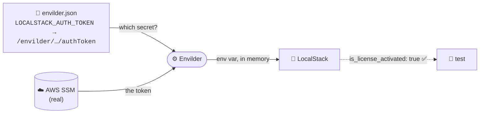
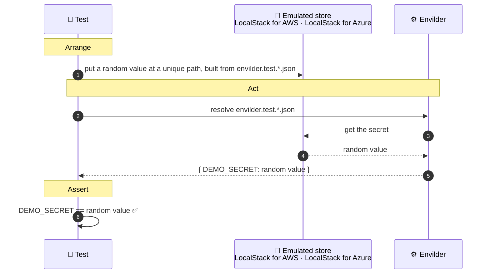

# Envilder Examples

Runnable [Envilder](https://envilder.com) examples in **.NET**, **Python** and **TypeScript**. One committed map file says which secrets an app needs; Envilder resolves them from **AWS SSM** or **Azure Key Vault** at runtime, straight into memory. No `.env` file, nothing committed but names and paths.

What's inside:

- **Testcontainers and Aspire examples** that hand a LocalStack container its auth token from your real cloud, and resolve map files against emulated SSM and Key Vault ([what the tests prove](#what-the-tests-prove)).
- **Fail fast at startup** with the SDKs' contract validation ([details](#fail-fast-at-startup-contract-validation)).
- **The CLI with nothing installed**: [`envilder exec`](#run-any-command-with-its-secrets-envilder-exec) runs any command with its secrets, and [`envilder validate`](#check-before-you-run-envilder-validate) checks the map file before you run.
- **CI** that runs every example on each pull request ([how](#continuous-integration)).

How much code does it take to feed a secret from AWS SSM into a LocalStack container, with nothing on disk and nothing committed?

This much:

```typescript
const env = await Envilder.resolveFile('envilder.json');

const localstack = await new LocalstackContainer('localstack/localstack:stable')
  .withEnvironment(Object.fromEntries(env))
  .start();
```

Plus one committed file that maps names to paths. Paths, not values, so it's safe in Git:

```json
{
  "LOCALSTACK_AUTH_TOKEN": "/envilder/development/localstack/authToken"
}
```

> [!IMPORTANT]
> [`envilder.json`](./envilder.json) points at the SSM key **`/envilder/development/localstack/authToken`**. That key must exist in your AWS account and hold your LocalStack token, and you need the [AWS CLI](https://aws.amazon.com/cli/) installed and logged in. See [Store your LocalStack token](#store-your-localstack-token-once).

That's the entire integration. [Envilder](https://envilder.com) resolves the token from your cloud at runtime: SSM → memory → container. No `.env`, no export, no bash script per stack. This repo shows it in five setups, for **AWS SSM** and **Azure Key Vault**.

## What the tests prove

Every Testcontainers and Aspire example tells the same two stories (the `*-custom-provider` examples tell a different one, [below](#bring-your-own-secret-store-a-custom-provider)).

### 1. Envilder hands your containers their secrets

LocalStack refuses to start its Pro features without an auth token. Envilder fetches it from your **real** AWS account and passes it straight into the container:



Test: `Should_ActivateLicense_When_…StartsLocalStackWithTokenResolvedByEnvilder`. It passes only if Envilder found the real token and LocalStack accepted it.

### 2. Envilder turns a map file into environment variables

The same test, once per cloud. It copies the map file with a secret name no other test uses, stores a random value there, asks Envilder to resolve it, and checks that the value matches:



Tests: `Should_ResolveSecretFromSsm_When_MapFilePointsToIt` and `Should_ResolveSecretFromKeyVault_When_MapFilePointsToIt`. A fresh random value on every run means a pass can only come from what Envilder just read.

**Every test stands on its own.** Each example is its own test project and starts its own emulators: one of each kind, shared by all the tests of that project only, so they can run in parallel. No example reuses another example's containers (the Testcontainers and Aspire examples of the same language never share one). Each test stores its own uniquely named secrets in its Arrange and deletes them when it ends, so no test depends on another test's data, on the order they run in, or on what a previous run left behind.

> **The one line that differs from production.** In your app you write `Env.ResolveFileAsync("envilder.json")` and Envilder builds the cloud client for you. The tests build that client themselves, aimed at the emulator, and pass it to `EnvilderClient`. Everything after that line is the exact code your app runs.

### Fail fast at startup: contract validation

The Aspire AppHosts resolve `envilder.json` with contract validation on (SDK `1.1.0` or newer). Before reading anything, Envilder checks that the map file is valid and that every secret it declares exists, without reading any value. If the LocalStack token was never pushed, the AppHost stops with an error naming `LOCALSTACK_AUTH_TOKEN` and its path, instead of letting LocalStack exit with a license error:

```csharp
var environment = await Env.FromMapFile("envilder.json")
	.WithContractValidation()
	.ResolveAsync();
```

The same check returns a result instead of failing with `ValidateContractAsync()` (.NET), `validate_contract()` (Python) or `validateContract()` (Node.js), with one status per variable: `exists`, `missing`, `access_denied`, `authentication_failed` or `provider_error`. It needs `ssm:GetParameters` on the token (or permission to list the vault's secrets with Option B), besides the read permission the resolve already uses.

## Run any command with its secrets: `envilder exec`

No code at all? [`envilder exec`](https://github.com/macalbert/envilder/blob/main/docs/exec-command.md) resolves the map file and starts a command with the values in its environment. Nothing is written to disk, so there's no `.env` to gitignore or clean up:

```bash
# SSM -> memory -> container, in one line (from the repo root)
npx envilder exec docker run --rm --env LOCALSTACK_AUTH_TOKEN localstack/localstack:stable
```

That's it: no `.env`, no export, no script. `--env LOCALSTACK_AUTH_TOKEN` (no `=value`) tells Docker to copy the variable from the environment Envilder just built, so the token never touches the disk or the command line. Ctrl+C stops it and `--rm` cleans up the container. Needs Docker and the same SSM token as the rest of the repo.

Worth knowing, from the [exec docs](https://github.com/macalbert/envilder/blob/main/docs/exec-command.md):

- **Fail-closed.** If any secret is missing, empty or unreadable, the command is not started and Envilder exits with `125`. Pull mode only warns.
- **Exit codes follow your command** (`n`, or `128 + n` for a signal), so Envilder's own failures (`125`) stay distinguishable.
- **Envilder options go first**; the command starts at the first non-option, so `--` is only needed when the command itself starts with a dash. No shell is involved: use `envilder exec sh -c '...'` if you need one.
- **Not a sandbox.** The command and everything it starts can read the secrets.

## Check before you run: `envilder validate`

[`envilder validate`](https://github.com/macalbert/envilder/blob/main/docs/validate-command.md) is the preflight for `exec` and pull, and the CLI side of the same contract check:

```bash
# The map file only: JSON, schema, provider settings. No cloud call, no credentials
npx envilder validate --offline

# Also asks the provider whether every declared secret exists, without reading it
npx envilder validate
```

It exits with `0` when every check passes and `1` otherwise, and it never prints a secret value. The [CLI guide](./cli/README.md) walks through both, with a CI example. Comparing a local `.env` with the map file (`--envfile`, `--compare-values`) ships in the next CLI release after `0.20.0`.

## Bring your own secret store: a custom provider

AWS SSM and Azure Key Vault are the two providers Envilder ships with, but the SDKs (1.2+) accept any provider you write. `withSecretProvider()` (`with_secret_provider()` in Python, `WithSecretProvider()` in .NET) hands the fluent builder your own instance; the map file, contract validation and injection work exactly as before:

```typescript
await Envilder.fromMapFile('envilder.vault.json')
  .withSecretProvider(new LocalVaultProvider(vaultPath, key))
  .withContractValidation()
  .inject();
```

To show it without any cloud, the `*-custom-provider` folders build a deliberately tiny "secret store": a local JSON file whose values are encrypted with AES-256-GCM, and a provider of about 40 lines that reads it. Two methods are all it takes:

| Method | Interface | What Envilder uses it for |
|--------|-----------|---------------------------|
| `getSecrets` / `get_secret` / `GetSecret` | `ISecretProvider` | Resolving the values to inject |
| `checkSecretsExist` / `check_secrets_exist` / `CheckSecretsExistAsync` | `ISecretExistenceChecker` (optional) | Contract validation: checking every key exists **without reading any value** |

The same pattern gives you an in-memory fake for your own tests: no account, no emulator, no environment variables. The local vault is a teaching prop, **not** a secret store to use for real.

## The examples

| Folder | Stack | Run it (from the folder) |
|--------|-------|--------|
| [`typescript-testcontainers/`](./typescript-testcontainers) | Vitest + Testcontainers | `npm install && npm test` |
| [`python-testcontainers/`](./python-testcontainers) | pytest + Testcontainers (uv) | `uv run pytest` |
| [`dotnet-testcontainers/`](./dotnet-testcontainers) | xUnit v3 + Testcontainers | `dotnet test` |
| [`dotnet-aspire/`](./dotnet-aspire) | Aspire AppHost + `Aspire.Hosting.Testing` | `cd AppHost.Tests && dotnet test` |
| [`typescript-aspire/`](./typescript-aspire) | Aspire [TypeScript AppHost](https://devblogs.microsoft.com/aspire/aspire-typescript-apphost/) | `npm install && npm test` * |
| [`typescript-custom-provider/`](./typescript-custom-provider) | Vitest, custom provider over a local encrypted vault (no cloud, no Docker) | `npm install && npm test` |
| [`python-custom-provider/`](./python-custom-provider) | pytest (uv), same custom provider | `uv run pytest` |
| [`dotnet-custom-provider/`](./dotnet-custom-provider) | xUnit v3, same custom provider | `dotnet test` |
| [`cli/`](./cli) | `npx envilder` push, validate, pull and exec, from a computer with nothing installed | follow the [README](./cli/README.md) |

Each folder has its own README with the order to read its files in. Each folder is self-contained: there is no `package.json` at the repo root, so run the command inside the folder. The .NET examples also share a solution, so `dotnet test` from the repo root runs all of them.

Testcontainers and Aspire are alternative orchestrators; pick the folder that matches your project. (Aspire AppHosts can also orchestrate [Python](https://aspire.dev/integrations/frameworks/python/) and JavaScript apps.)

\* Needs the [Aspire CLI](https://aspire.dev) 13.5+. There's no TypeScript `Aspire.Hosting.Testing` yet, so the tests spawn `aspire run` and wait for the emulators to answer. The first run generates `.modules/` and `.aspire/` (both git-ignored).

### The map files

All examples share the map files at the repo root:

| File | Maps | Points at |
|------|------|-----------|
| [`envilder.json`](./envilder.json) | `LOCALSTACK_AUTH_TOKEN` | your **real** AWS SSM or Azure Key Vault ([options](#store-your-localstack-token-once)) |
| [`envilder.test.aws.json`](./envilder.test.aws.json) | `DEMO_SECRET` → an SSM path | LocalStack's SSM |
| [`envilder.test.azure.json`](./envilder.test.azure.json) | `DEMO_SECRET` → a Key Vault secret name | LocalStack for Azure |
| [`envilder.vault.json`](./envilder.vault.json) | `DB_PASSWORD`, `API_KEY` | the local encrypted vault of the `*-custom-provider` examples |

The two `test` files only differ in `$config.provider` and in the shape of the identifier: SSM uses paths (`/a/b`), Key Vault uses names (`a-b`).

### The emulators

| Cloud | Emulator | Needs |
|-------|----------|-------|
| AWS SSM | [LocalStack](https://localstack.cloud) | an auth token (fetched by Envilder, see story 1) |
| Azure Key Vault | [LocalStack for Azure](https://docs.localstack.cloud/azure/) | the same auth token (fetched by Envilder, see story 1) |

LocalStack for Azure starts empty, so the tests create a vault through its Resource Manager API and sign in with a placeholder service principal, through a small local token endpoint. Each folder's README lists the few lines that deal with that. You won't need them against real Azure.

## Before you run (once)

Install only what the folders you want need:

| Tool | Version | Used by |
|------|---------|---------|
| [Docker](https://www.docker.com/) | any recent | all except `*-custom-provider` |
| [AWS CLI](https://aws.amazon.com/cli/), logged in | v2 | all except `*-custom-provider` (to read the LocalStack token from SSM) |
| [Node.js](https://nodejs.org/) | 24 LTS or newer (see [`.nvmrc`](./.nvmrc)) | `typescript-*` |
| [uv](https://docs.astral.sh/uv/) | any recent; it installs Python 3.14 for you | `python-*` |
| [.NET SDK](https://dotnet.microsoft.com/download) | 10.0 (see [`global.json`](./global.json)) | `dotnet-*` |
| [Aspire CLI](https://aspire.dev/get-started/install-cli/) | 13.5+ | `typescript-aspire` |

### Store your LocalStack token (once)

You need a [LocalStack auth token](https://docs.localstack.cloud/aws/getting-started/auth-token/) in your own cloud. Envilder resolves it from AWS SSM or Azure Key Vault. Pick one and push the token with one command from the repo root: a single push stores the secret **and** records the mapping in [`envilder.json`](./envilder.json), so you don't write the map file by hand.

#### Option A: AWS SSM Parameter Store (default)

Needs the [AWS CLI](https://aws.amazon.com/cli/) installed and logged in (`aws configure` or `aws sso login`), so Envilder can read and write `/envilder/development/localstack/authToken`.

```bash
npx envilder --push   --key=LOCALSTACK_AUTH_TOKEN   --value=<your-token>   --secret-path=/envilder/development/localstack/authToken
```

The committed `envilder.json` already maps `LOCALSTACK_AUTH_TOKEN` to that path, so the push leaves it as it is. Without the file, the push creates it:

```json
{
  "LOCALSTACK_AUTH_TOKEN": "/envilder/development/localstack/authToken"
}
```

Using a named AWS profile? Pass `--profile=my-profile` to the push. The push never writes the profile into the map file, so add it to `$config` once, and the tests and AppHosts use it too:

```json
{
  "$config": { "provider": "aws", "profile": "my-profile" },
  "LOCALSTACK_AUTH_TOKEN": "/envilder/development/localstack/authToken"
}
```

#### Option B: Azure Key Vault

Needs an Azure login (`az login`) with permission to read and write secrets in your vault. Key Vault secret names allow only letters, digits and dashes, so the identifier is a name, not a path.

The committed `envilder.json` targets AWS, and a push to Azure won't add its mapping to a map file that points at another provider. Delete it first, then push with the provider and the vault:

```bash
rm envilder.json
npx envilder --push   --provider=azure   --vault-url=https://<your-vault>.vault.azure.net   --key=LOCALSTACK_AUTH_TOKEN   --value=<your-token>   --secret-path=localstack-auth-token
```

The push creates a new `envilder.json` with the Azure `$config`:

```json
{
  "$config": {
    "provider": "azure",
    "vaultUrl": "https://<your-vault>.vault.azure.net"
  },
  "LOCALSTACK_AUTH_TOKEN": "localstack-auth-token"
}
```

#### Check it

```bash
npx envilder validate
```

It confirms that `envilder.json` is valid and that the token exists, without reading or printing it (see [Check before you run](#check-before-you-run-envilder-validate)).

Nothing else changes. The tests call `Envilder.resolveFile('envilder.json')`, the AppHosts call `Envilder.fromMapFile('envilder.json').withContractValidation()`, and the `$config` block decides where the token comes from. See [providers](https://envilder.com/#providers) and the [push docs](https://github.com/macalbert/envilder/blob/main/docs/push-command.md#map-file-update).

## Continuous integration

[`.github/workflows/tests.yml`](./.github/workflows/tests.yml) runs every example's tests on each pull request and on `main`, one runner per example so their emulators never share a Docker daemon. Like a developer machine, CI gets the LocalStack token through Envilder from AWS SSM, so the repository needs two secrets: `AWS_ROLE_TO_ASSUME` (an IAM role trusted by GitHub OIDC for this repository, allowed to read `/envilder/development/localstack/authToken`) and `AWS_REGION`. Pull requests from forks cannot get those credentials, so the jobs skip there.

## Updating dependencies

Versions are pinned in one place per ecosystem, so an upgrade is one command each:

| Ecosystem | Where versions live | Upgrade |
|-----------|---------------------|---------|
| .NET | [`Directory.Packages.props`](./Directory.Packages.props) (NuGet), [`global.json`](./global.json) (SDK + `Aspire.AppHost.Sdk`) | `dotnet outdated envilder-examples.slnx -u` ([dotnet-outdated](https://github.com/dotnet-outdated/dotnet-outdated)) |
| Python | [`pyproject.toml`](./python-testcontainers/pyproject.toml) + `uv.lock` | `uv lock --upgrade` |
| Node | each folder's `package.json` + `package-lock.json` | `npx npm-check-updates -u && npm install` |
| Aspire (TypeScript) | [`aspire.config.json`](./typescript-aspire/aspire.config.json) | `aspire update`, then delete `.modules/` so it regenerates |

When you bump Aspire, update the `Aspire.AppHost.Sdk` version in `global.json` and `Aspire.Hosting.Testing` in `Directory.Packages.props` together.

## Links

- [Envilder](https://github.com/macalbert/envilder) · [envilder.com](https://envilder.com)
- Blog: [Envilder + Testcontainers + LocalStack: integration tests that fetch their own secrets](https://dev.to/macalbert)
