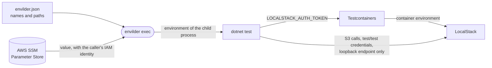

# Build and test with AI coding agents using Envilder

A .NET 10 document storage API (upload and download files in Amazon S3), built
test first, whose integration tests need a secret: the LocalStack auth token.
The example shows how an AI coding agent, a developer and CI can all work with
**the same versioned secret contract**, without anyone copying the secret value
into a prompt, a `.env` file or the repository.

- [The problem](#the-problem)
- [What Envilder contributes](#what-envilder-contributes)
- [The example](#the-example)
- [Prerequisites](#prerequisites)
- [Run without secrets](#run-without-secrets)
- [Run the integration tests with Envilder](#run-the-integration-tests-with-envilder)
- [Work with Claude Code or Codex](#work-with-claude-code-or-codex)
- [Security limitations](#security-limitations)
- [Verified results](#verified-results)

More detail: [security and threat model](docs/security.md) ·
[agent workflow and recording plan](docs/agent-workflow.md) ·
[troubleshooting](docs/troubleshooting.md).

## The problem

An application, or an agent working on it, needs configuration. Some of it is
secret. The usual way to get it there:

- someone copies secret values into a local `.env` file, or pastes them into a
  terminal or an agent prompt;
- every developer machine, CI pipeline and agent environment keeps its own copy,
  synchronized by hand;
- the copies drift between environments, and nobody can say which version a
  failing run used;
- the files sit in the workspace, readable by every local tool and process,
  including an AI agent that reads files to understand the project.

A `.env` file is not insecure in itself. The cost is the manual distribution and
the extra copies.

## What Envilder contributes

- **One versioned contract.** [`envilder.json`](./envilder.json) maps each
  variable name to a secret identifier. It holds names and paths, never values,
  so it is committed and reviewed like code.

  ```json
  {
    "LOCALSTACK_AUTH_TOKEN": "/envilder/development/localstack/authToken"
  }
  ```

- **The cloud provider stays the source of truth.** The value lives in AWS SSM
  Parameter Store. IAM decides who can read it.
- **Agents read the contract, not the value.** An agent can learn which secrets
  a project needs, and how to run a command that gets them, from the map file
  and the [Envilder skill](./.claude/skills/envilder/SKILL.md).
- **Resolution is delegated.** `envilder exec` resolves the mapped secrets with
  the caller's cloud identity and starts a command with them in its environment.
  It writes no `.env` file and no temporary file.
- **Applications keep reading environment variables.** This API and its tests
  reference no Envilder package.

Envilder does **not** isolate the command it starts, and it is not an agent
security control. See [Security limitations](#security-limitations).

## The example

```text
ai-agent-dotnet/
  envilder.json                              the secret contract
  package.json                               pins the Envilder CLI (0.22.0)
  .claude/skills/envilder/                   the Envilder agent skill, pinned to v0.22.0
  src/DocumentStorage.Api/
    Program.cs                               wiring: options, AWS SDK, endpoints
    Documents/                               DocumentId, Document, DocumentService, endpoints, IDocumentStorage
    Storage/                                 S3DocumentStorage (the only AWS SDK code), DocumentStorageOptions
  tests/DocumentStorage.UnitTests/           no Docker, no cloud: storage replaced in memory
  tests/DocumentStorage.IntegrationTests/    real AWS SDK against LocalStack S3 (Testcontainers)
```

| Endpoint | Behaviour |
|----------|-----------|
| `POST /documents` (multipart field `file`) | `201 Created`, `Location: /documents/{id}`, body `{ "id": "..." }`. `400` for a missing or empty file or one over 10 MB |
| `GET /documents/{id}` | The bytes with their original `Content-Type`. `400` for an id that is not a GUID, `404` when no document has that id |

The API reads one setting, `DocumentStorage:BucketName` (for example from the
`DocumentStorage__BucketName` environment variable), and gets AWS region and
credentials from the AWS SDK's default chain. It does not know whether they
came from Envilder, a container, a profile or an instance role.

How the secret reaches the emulator in the integration tests:



## Prerequisites

| Tool | Version used | Needed for |
|------|--------------|-----------|
| .NET SDK | 10.0 (see [`global.json`](../global.json)) | build and tests |
| Node.js | 22.12 or later (the repo's [`.nvmrc`](../.nvmrc) says 24) | the Envilder CLI |
| Envilder CLI | 0.22.0, pinned in [`package.json`](./package.json) | validate and exec |
| Docker | any recent engine | integration tests only |
| AWS CLI | v2 | signing in, integration tests only |

For the integration tests you also need an AWS identity that can read
`/envilder/development/localstack/authToken` (`ssm:GetParameter`), and that
parameter must hold a valid LocalStack auth token: LocalStack quits at startup
without one, even for S3 (see [troubleshooting](docs/troubleshooting.md#localstack-quits-with-license-activation-failed)).
[Store your LocalStack token](../README.md#store-your-localstack-token-once)
explains how to create it.

## Run without secrets

Nothing here needs AWS credentials, Docker or a token. Run from this folder:

```powershell
npm ci
```

```powershell
npx --no envilder validate --offline --map=envilder.json
```

```powershell
dotnet test --project tests/DocumentStorage.UnitTests
```

`validate --offline` checks the JSON, the schema and the provider settings
without calling AWS. The unit tests replace storage in memory, so they run on
a clean machine.

## Run the integration tests with Envilder

This step **reads a real secret**. Run it yourself, or authorize it explicitly
when an agent asks.

1. Sign in to AWS with your usual identity (profile, SSO session or
   environment credentials).
2. Run from this folder, adding `--profile <name>` if your identity is a named
   profile:

   ```powershell
   npx --no envilder exec --map=envilder.json -- dotnet test --project tests/DocumentStorage.IntegrationTests
   ```

Envilder resolves the token, prints `envilder: 1 secret resolved (aws...) →
dotnet …` and starts `dotnet test` with `LOCALSTACK_AUTH_TOKEN` in its
environment. Testcontainers passes it to the LocalStack container. The test
run's exit code becomes Envilder's exit code. If the token cannot be resolved,
the tests never start and the exit code is `125`.

Never pass the token on a command line, and do not create a `.env` file for
it: the fixture reads the variable from the process environment only.

The same command is in `package.json` as `npm run test:integration`.

## Work with Claude Code or Codex

The full workflow, the authorization points, the agent permissions and the
recording plan are in [docs/agent-workflow.md](docs/agent-workflow.md). In short:

1. **The skill.** [`.claude/skills/envilder/`](./.claude/skills/envilder/) is
   the published Envilder skill, installed and pinned with:

   ```powershell
   gh skill install macalbert/envilder envilder --pin v0.22.0 --dir ai-agent-dotnet/.claude/skills
   ```

   Claude Code reads `.claude/skills/` from the folder the session starts in,
   so start the agent **in `ai-agent-dotnet/`**. For Codex, install it into
   `.agents/skills/` instead (`--agent codex`); that path is documented by the
   skill but not verified in this example.
2. **The task.** Give the agent [the prompt](docs/agent-workflow.md#the-prompt).
3. **What the agent can do on its own:** read the code and `envilder.json`,
   write tests and code, run the unit tests and `validate --offline`.
4. **Where it must stop:** before `envilder exec` (or anything else that reads
   a secret), before pushing, and it never approves or merges its own pull
   request.
5. **Trusted execution:** a maintainer reviews the change, then runs the
   integration tests locally or approves the CI job, which runs in the
   protected `integration` environment.

## Security limitations

The full threat model is in [docs/security.md](docs/security.md). The points
that matter most:

- **`envilder exec` is not a sandbox.** The command it starts, and every process
  that command starts, can read the token. Code that an agent wrote and that
  you run through `exec` can send the token anywhere it has network access to.
- **Approving a command is not isolation.** If an agent can edit the tests and
  you then run them with secrets, the agent's code runs with the secret.
  Review the code before the privileged run.
- **An agent with shell access and your cloud credentials can resolve the
  secret itself.** Keep cloud credentials out of the agent's environment
  (isolated container, no `~/.aws` mount) instead of relying on instructions.
- **Docker keeps the container's environment** in its metadata
  (`docker inspect`) while the container exists. Testcontainers removes the
  container after the run.
- **IAM is the real boundary.** In CI, the role can read only this one
  parameter, and only jobs a maintainer approved can assume it. Locally, the
  run uses your own identity, with whatever permissions it has.

## Verified results

Run on Windows 11 ARM64, .NET SDK 10.0.404, Node 24.20.0, Docker 29.9.3,
Envilder 0.22.0, on 2026-11-18.

| Command (from this folder) | Exit | Result |
|----------------------------|------|--------|
| `npx --no envilder validate --offline --map=envilder.json` | 0 | `Map file valid` |
| `dotnet test --project tests/DocumentStorage.UnitTests` | 0 | 25 passed |
| `dotnet test --project tests/DocumentStorage.IntegrationTests` (no Envilder) | 2 | 7 failed: `LOCALSTACK_AUTH_TOKEN is not set` |
| same, with a synthetic invalid token | 2 | 7 failed: LocalStack `License activation failed!`, container exit code 55 |
| `npx --no envilder exec --map=envilder.json --profile mac -- dotnet test --project tests/DocumentStorage.IntegrationTests` | 0 | 7 passed |

After the Envilder run: no `.env` file in the folder, no token-like string in
the captured output, no LocalStack container left running.

The test-first history is in the commits of this example: each red commit
records the failing run, each green commit the passing one. The run of an AI
agent on this task is documented separately in
[docs/agent-workflow.md](docs/agent-workflow.md#agent-run-evidence).
