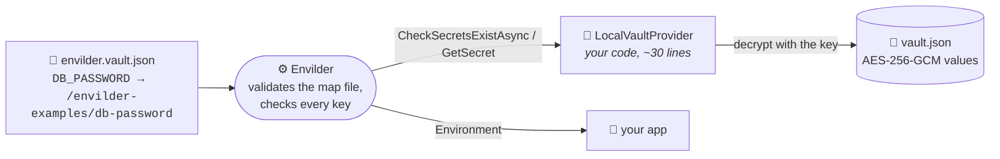

# .NET: bring your own secret store

**xUnit v3 · `Envilder` 1.2+ · `System.Security.Cryptography.AesGcm` · no cloud, no Docker**

```bash
dotnet test
```

Nothing to set up: no AWS account, no emulator, no token. The tests create a throwaway encrypted vault in a temp file and point Envilder at it.

## The idea in one picture

Envilder never talks to a cloud directly. It talks to a **provider**: anything that can answer "give me this secret" and, optionally, "do these secrets exist?". AWS SSM and Azure Key Vault are just the two providers it ships with. `WithSecretProvider()` lets you hand it your own.



The "vault" here is deliberately tiny: a JSON file whose values are encrypted with AES-256-GCM. It is a **teaching prop, not a secret store**: the key lives in memory, there is no rotation and no access control. Swap it for HashiCorp Vault, 1Password, a database, or an in-memory fake in your tests: the Envilder side does not change.

## Read the code in this order

1. **[`LocalVault.cs`](./LocalVault.cs)**: `Seal()` and `Open()`, the "basic encryptor". Each value is `base64(iv | ciphertext | tag)`. Skim it; it is not about Envilder.
2. **[`LocalVaultProvider.cs`](./LocalVaultProvider.cs)**: the whole integration.
   - `GetSecret(name)` / `GetSecretAsync(name)` (`ISecretProvider`) decrypt and return the value, or `null` when the secret does not exist.
   - `CheckSecretsExistAsync(names)` (`ISecretExistenceChecker`) answers `Exists` or `Missing` **without decrypting anything**. This is the optional part that lets `WithContractValidation()` and `ValidateContractAsync()` check the map file before your app starts.
3. **[`LocalVaultProviderTests.cs`](./LocalVaultProviderTests.cs)**: three tests, one story each.

Both interfaces live in `Envilder.Domain.Ports`, so the provider file needs `using Envilder.Domain.Ports;` next to `using Envilder;`.

## What the tests prove

| Test | Proves |
|------|--------|
| `Should_InjectDecryptedSecrets_When_VaultHoldsEveryMappedSecret` | The map file plus your provider is all Envilder needs: the decrypted values land in the process environment |
| `Should_FailAtStartupWithoutInjecting_When_MappedSecretIsMissing` | With `WithContractValidation()`, a missing secret stops the load before anything is injected, and `ContractValidationException` names the key, never a value |
| `Should_ReportEachKeyWithoutDecrypting_When_ContractIsValidated` | `ValidateContractAsync()` only calls `CheckSecretsExistAsync`: it works even with the wrong key, because no value is decrypted |

## The line to look at

```csharp
await Env.FromMapFile("envilder.vault.json")
    .WithSecretProvider(new LocalVaultProvider(vaultPath, key))
    .WithContractValidation()
    .InjectAsync();
```

Remove `.WithSecretProvider(...)` and the same line resolves the map file against AWS SSM or Azure Key Vault, as configured in `$config`. The map file is validated the same way in both cases, so a mistake in it fails here too.

## Do I need `ISecretExistenceChecker`?

Only for contract validation. A provider that implements just `ISecretProvider` still resolves secrets, but `ValidateContractAsync()` reports every key as `ProviderError` (Envilder cannot ask it whether a secret exists), so `WithContractValidation()` fails the load on purpose instead of passing silently.

The same example exists for [TypeScript](../typescript-custom-provider) and [Python](../python-custom-provider), with the same vault format: a vault sealed by one opens in the others.
