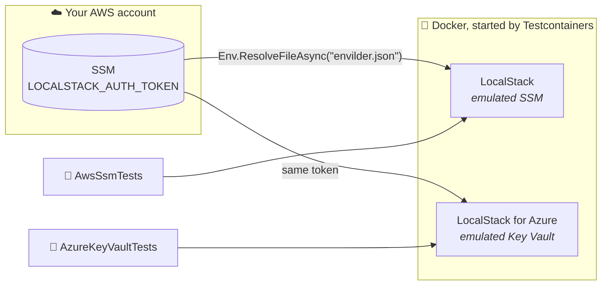

# .NET + Testcontainers

**xUnit v3 · Testcontainers · LocalStack (AWS and Azure)**

```bash
dotnet test
```

> **Before you run:** [`envilder.json`](../envilder.json) maps `LOCALSTACK_AUTH_TOKEN` to the SSM key `/envilder/development/localstack/authToken`, so that key must hold your LocalStack token in your AWS account, and you need the [AWS CLI](https://aws.amazon.com/cli/) installed and logged in (`aws configure` or `aws sso login`). See [Store your LocalStack token](../README.md#store-your-localstack-token-once).

## What happens when you run it



Three tests, two stories (see the [root README](../README.md#what-the-tests-prove)):

| Test | Proves |
|------|--------|
| `Should_ActivateLicense_When_LocalStackStartsWithTokenResolvedByEnvilder` | Envilder fetched the real token and LocalStack accepted it |
| `Should_ResolveSecretFromSsm_When_MapFilePointsToIt` | Envilder resolves `envilder.test.aws.json` against SSM |
| `Should_ResolveSecretFromKeyVault_When_MapFilePointsToIt` | Envilder resolves `envilder.test.azure.json` against Key Vault in LocalStack for Azure |

## Read the code in this order

1. **[`LocalStackFixture.cs`](./LocalStackFixture.cs)** shows the whole integration in two statements: `Env.ResolveFileAsync("envilder.json")`, then `.WithEnvironment(secrets)`.
2. **[`AwsSsmTests.cs`](./AwsSsmTests.cs)** holds the first two tests. In the second, look at the `Act` block: that is everything Envilder does.
3. **[`AzureKeyVaultTests.cs`](./AzureKeyVaultTests.cs)** is the same test against Key Vault. Compare it with the SSM one: only the map file and the client change.
4. **[`LocalStackAzureFixture.cs`](./LocalStackAzureFixture.cs)** is emulator plumbing (plus [`ManagedIdentityEndpointStub.cs`](./ManagedIdentityEndpointStub.cs)). Skim it.

## The line to look at

Your app resolves a map file in one call, and Envilder builds the cloud client for you:

```csharp
var secrets = await Env.ResolveFileAsync("envilder.test.aws.json");
```

The tests need that client aimed at an emulator, so they build it themselves and hand it to Envilder:

```csharp
var sut = new EnvilderClient(new AwsSsmSecretProvider(localStack.Ssm));
var secrets = await sut.ResolveSecretsAsync(mapFile);
```

Everything after that line is the same code your app runs.

## Emulator-only bits

You won't need these against real clouds:

| Where | What | Why |
|-------|------|-----|
| `LocalStackFixture` | `BasicAWSCredentials("test", "test")` | LocalStack accepts any credentials |
| `LocalStackAzureFixture` | free host port bound to the same container port, `GATEWAY_LISTEN`, `LOCALSTACK_HOST` | vault URLs embed the gateway port |
| `LocalStackAzureFixture` | `ClientSecretCredential` with a placeholder service principal and `DisableInstanceDiscovery` | the emulator accepts any principal; it creates the vault through the ARM API and returns its `vaultUri` |
| `LocalStackAzureFixture` / `ManagedIdentityEndpointStub` | `IDENTITY_ENDPOINT` / `IDENTITY_HEADER`, other `AZURE_*` variables cleared | a tiny local token endpoint lets `DefaultAzureCredential` get its token, as it would from Azure on an App Service |

TLS and challenge-resource verification stay on: `*.localhost.localstack.cloud` resolves to `127.0.0.1` with a valid certificate. Like the SSM test, the Azure test needs the LocalStack token.
