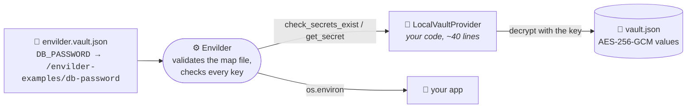

# Python: bring your own secret store

**pytest · `envilder` 1.2+ · `cryptography` · no cloud, no Docker**

```bash
uv run pytest
```

Nothing to set up: no AWS account, no emulator, no token. The tests create a throwaway encrypted vault in a temp folder and point Envilder at it.

## The idea in one picture

Envilder never talks to a cloud directly. It talks to a **provider**: anything that can answer "give me this secret" and, optionally, "do these secrets exist?". AWS SSM and Azure Key Vault are just the two providers it ships with. `with_secret_provider()` lets you hand it your own.



The "vault" here is deliberately tiny: a JSON file whose values are encrypted with AES-256-GCM. It is a **teaching prop, not a secret store**: the key lives in memory, there is no rotation and no access control. Swap it for HashiCorp Vault, 1Password, a database, or an in-memory fake in your tests: the Envilder side does not change.

## Read the code in this order

1. **[`local_vault.py`](./local_vault.py)**: `seal()` and `open_sealed()`, the "basic encryptor". Each value is `base64(iv | ciphertext | tag)`. Skim it; it is not about Envilder.
2. **[`local_vault_provider.py`](./local_vault_provider.py)**: the whole integration. Two methods:
   - `get_secret(name)` (`ISecretProvider`) decrypts and returns the value, or `None` when the secret does not exist.
   - `check_secrets_exist(names)` (`ISecretExistenceChecker`) answers `EXISTS` or `MISSING` **without decrypting anything**. This is the optional part that lets `with_contract_validation()` and `validate_contract()` check the map file before your app starts.
3. **[`test_local_vault_provider.py`](./test_local_vault_provider.py)**: three tests, one story each.

## What the tests prove

| Test | Proves |
|------|--------|
| `Should_InjectDecryptedSecrets_When_VaultHoldsEveryMappedSecret` | The map file plus your provider is all Envilder needs: the decrypted values land in `os.environ` |
| `Should_FailAtStartupWithoutInjecting_When_MappedSecretIsMissing` | With `with_contract_validation()`, a missing secret stops the load before anything is injected, and the error names the key, never a value |
| `Should_ReportEachKeyWithoutDecrypting_When_ContractIsValidated` | `validate_contract()` only calls `check_secrets_exist`: it works even with the wrong key, because no value is decrypted |

## The line to look at

```python
(
    Envilder.from_map_file("../envilder.vault.json")
    .with_secret_provider(LocalVaultProvider(vault_path, key))
    .with_contract_validation()
    .inject()
)
```

Remove `.with_secret_provider(...)` and the same line resolves the map file against AWS SSM or Azure Key Vault, as configured in `$config`. The map file is validated the same way in both cases, so a mistake in it fails here too.

## Do I need `ISecretExistenceChecker`?

Only for contract validation. A provider that implements just `ISecretProvider` still resolves secrets, but `validate_contract()` reports every key as `PROVIDER_ERROR` (Envilder cannot ask it whether a secret exists), so `with_contract_validation()` fails the load on purpose instead of passing silently.

Both are `Protocol`s: subclassing them, as this example does, is optional but makes the intent explicit and lets type checkers verify the method signatures.

The same example exists for [TypeScript](../typescript-custom-provider) and [.NET](../dotnet-custom-provider), with the same vault format: a vault sealed by one opens in the others.
