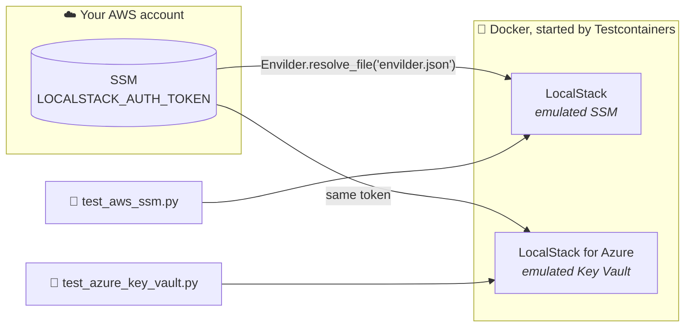

# Python + Testcontainers

**pytest · Testcontainers · uv · LocalStack · LocalStack for Azure**

```bash
uv run pytest
```

> **Before you run:** [`envilder.json`](../envilder.json) maps `LOCALSTACK_AUTH_TOKEN` to the SSM key `/envilder/development/localstack/authToken`, so that key must hold your LocalStack token in your AWS account, and you need the [AWS CLI](https://aws.amazon.com/cli/) installed and logged in (`aws configure` or `aws sso login`). See [Store your LocalStack token](../README.md#store-your-localstack-token-once).

## What happens when you run it



Nine tests, three stories (see the [root README](../README.md#what-the-tests-prove)):

| Test | Proves |
|------|--------|
| `Should_ActivateLicense_When_LocalStackStartsWithTokenResolvedByEnvilder` | Envilder fetched the real token and LocalStack accepted it |
| `Should_ResolveSecretFromSsm_When_MapFilePointsToIt` | Envilder resolves `envilder.test.aws.json` against SSM |
| `Should_ResolveSecretFromKeyVault_When_MapFilePointsToIt` | Envilder resolves `envilder.test.azure.json` against Key Vault |
| `Should_ReportEveryKeyAsExists_When_ContractHoldsInSsm` / `…InKeyVault` | The contract check reports `exists` for every variable of `envilder.test.*.json` |
| `Should_ReportKeyAsMissing_When_SecretIsNotInSsm` / `…InKeyVault` | A variable whose secret was never stored is reported as `missing`, next to the one that `exists` |
| `Should_FailTheLoad_When_ContractValidationIsOnAndSecretIsNotInSsm` / `…InKeyVault` | With contract validation on, the load fails and the error names the variable and its path, never a value |

## Read the code in this order

1. **[`test_aws_ssm.py`](./test_aws_ssm.py)**: the `localstack` fixture is the whole integration in two statements, `Envilder.resolve_file(...)` and `container.env.update(secrets)`. Then come the first two tests. In the second, look at the `Act` block: that is everything Envilder does.
2. **[`test_azure_key_vault.py`](./test_azure_key_vault.py)** is the same test against Key Vault. Its `secrets` fixture resolves the same token, and the emulator plumbing lives in [`localstack_azure.py`](./localstack_azure.py), so skim it. The test itself only changes the map file and the client.
3. **The contract tests**, at the end of both files, call the builder your app uses (`from_map_file(...).validate_contract()` and `.with_contract_validation()`) with no client built by hand. They add the never-stored key to a copy of the map file in a temporary folder.

## The line to look at

Your app resolves a map file in one call, and Envilder builds the cloud client for you:

```python
secrets = Envilder.resolve_file("envilder.test.aws.json")
```

The tests need that client aimed at an emulator, so they build it themselves and hand it to Envilder:

```python
sut = EnvilderClient(AwsSsmSecretProvider(ssm))
secrets = sut.resolve_secrets(map_file)
```

Everything after that line is the same code your app runs.

For the contract check there is no such line: the tests call `Envilder.from_map_file(...)` exactly as your app would, and the emulator is chosen from outside (see below).

```python
result = Envilder.from_map_file("envilder.test.aws.json").validate_contract()
# result.is_valid, and one KeyCheck per variable: variable, path, status (SecretExistenceStatus.EXISTS, MISSING, ...)

secrets = Envilder.from_map_file("envilder.json").with_contract_validation().resolve()
# raises ContractValidationError naming each failing variable and path, never a value
```

## Emulator-only bits

You won't need these against real clouds:

| What | Why |
|------|-----|
| `aws_access_key_id="test"`, … | LocalStack accepts any credentials |
| `default_aws_client_on_localstack` fixture: `AWS_ENDPOINT_URL_SSM`, `AWS_ACCESS_KEY_ID`, … via `monkeypatch` | `Envilder.from_map_file` builds its boto3 client from the default credential chain, and these variables aim it at LocalStack for one test |
| `.with_vault_url(secrets.vault_url)` in the contract tests | the emulator's vault URL is only known at run time; a real map file has `$config.vaultUrl` |
| `LOCALSTACK_AUTH_TOKEN` | LocalStack for Azure needs the same token as the AWS emulator, resolved with Envilder |
| a free host port bound to the same container port, `GATEWAY_LISTEN`, `LOCALSTACK_HOST` | vault URLs embed the gateway port, so both ports must match |
| `ClientSecretCredential("any-app", "dummy")` with `disable_instance_discovery=True` | the emulator accepts a placeholder service principal (all-zero tenant and subscription) on `https://azure.localhost.localstack.cloud:<port>` |
| resource group and vault created through ARM | the emulator starts empty, so the test creates the vault and uses the returned `vaultUri` |
| `IDENTITY_ENDPOINT` / `IDENTITY_HEADER` | a tiny local token endpoint lets `DefaultAzureCredential` work through managed identity, as on an App Service; competing `AZURE_*` variables are cleared while it runs |

TLS verification and Key Vault challenge resource verification stay enabled: the emulator serves a trusted certificate on `*.vault.azure.localhost.localstack.cloud`.
