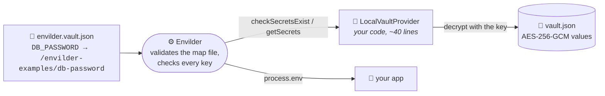

# TypeScript: bring your own secret store

**Vitest · `@envilder/sdk` 1.2+ · no cloud, no Docker**

```bash
npm install && npm test
```

Nothing to set up: no AWS account, no emulator, no token. The tests create a throwaway encrypted vault in a temp folder and point Envilder at it.

## The idea in one picture

Envilder never talks to a cloud directly. It talks to a **provider**: anything that can answer "give me these secrets" and, optionally, "do these secrets exist?". AWS SSM and Azure Key Vault are just the two providers it ships with. `withSecretProvider()` lets you hand it your own.



The "vault" here is deliberately tiny: a JSON file whose values are encrypted with AES-256-GCM. It is a **teaching prop, not a secret store**: the key lives in memory, there is no rotation and no access control. Swap it for HashiCorp Vault, 1Password, a database, or an in-memory fake in your tests: the Envilder side does not change.

## Read the code in this order

1. **[`local-vault.ts`](./local-vault.ts)**: `seal()` and `open()`, the "basic encryptor". Each value is `base64(iv | ciphertext | tag)`. Skim it; it is not about Envilder.
2. **[`local-vault-provider.ts`](./local-vault-provider.ts)**: the whole integration. Two methods:
   - `getSecrets(names)` (`ISecretProvider`) decrypts and returns the secrets that exist, and silently leaves out the ones that do not.
   - `checkSecretsExist(names)` (`ISecretExistenceChecker`) answers `exists` or `missing` **without decrypting anything**. This is the optional part that lets `withContractValidation()` and `validateContract()` check the map file before your app starts.
3. **[`local-vault-provider.test.ts`](./local-vault-provider.test.ts)**: three tests, one story each.

## What the tests prove

| Test | Proves |
|------|--------|
| `Should_InjectDecryptedSecrets_When_VaultHoldsEveryMappedSecret` | The map file plus your provider is all Envilder needs: the decrypted values land in `process.env` |
| `Should_FailAtStartupWithoutInjecting_When_MappedSecretIsMissing` | With `withContractValidation()`, a missing secret stops the load before anything is injected, and the error names the key, never a value |
| `Should_ReportEachKeyWithoutDecrypting_When_ContractIsValidated` | `validateContract()` only calls `checkSecretsExist`: it works even with the wrong key, because no value is decrypted |

## The line to look at

```typescript
await Envilder.fromMapFile('../envilder.vault.json')
  .withSecretProvider(new LocalVaultProvider(vaultPath, key))
  .withContractValidation()
  .inject();
```

Remove `.withSecretProvider(...)` and the same line resolves the map file against AWS SSM or Azure Key Vault, as configured in `$config`. The map file is validated the same way in both cases, so a mistake in it fails here too.

## Do I need `ISecretExistenceChecker`?

Only for contract validation. A provider that implements just `ISecretProvider` still resolves secrets, but `validateContract()` reports every key as `provider_error` (Envilder cannot ask it whether a secret exists), so `withContractValidation()` fails the load on purpose instead of passing silently.

The same example exists for [Python](../python-custom-provider) and [.NET](../dotnet-custom-provider), with the same vault format: a vault sealed by one opens in the others.
