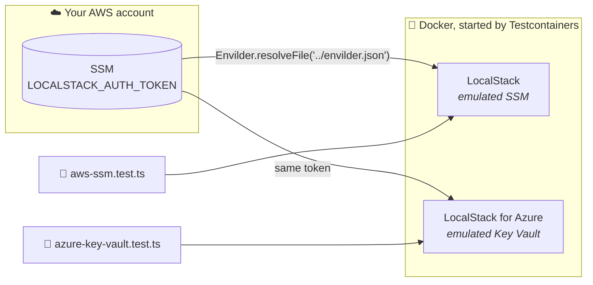

# TypeScript + Testcontainers

**Vitest · Testcontainers · LocalStack (AWS and Azure)**

```bash
npm install && npm test
```

> **Before you run:** [`envilder.json`](../envilder.json) maps `LOCALSTACK_AUTH_TOKEN` to the SSM key `/envilder/development/localstack/authToken`, so that key must hold your LocalStack token in your AWS account, and you need the [AWS CLI](https://aws.amazon.com/cli/) installed and logged in (`aws configure` or `aws sso login`). See [Store your LocalStack token](../README.md#store-your-localstack-token-once).

## What happens when you run it



Nine tests, three stories (see the [root README](../README.md#what-the-tests-prove)):

| Test | Proves |
|------|--------|
| `Should_ActivateLicense_When_LocalStackStartsWithTokenResolvedByEnvilder` | Envilder fetched the real token and LocalStack accepted it |
| `Should_ResolveSecretFromSsm_When_MapFilePointsToIt` | Envilder resolves `envilder.test.aws.json` against SSM |
| `Should_ResolveSecretFromKeyVault_When_MapFilePointsToIt` | Envilder resolves `envilder.test.azure.json` against Key Vault |
| `Should_ReportEveryKeyAsExists_When_ContractHoldsInSsm` / `…InKeyVault` | The contract check reports `exists` for every variable of `envilder.test.*.json` |
| `Should_ReportKeyAsMissing_When_SecretIsNotInSsm` / `…InKeyVault` | A variable whose secret was never stored is reported as `missing`, next to the one that `exists` |
| `Should_FailTheLoad_When_ContractValidationIsOnAndSecretIsNotInSsm` / `…InKeyVault` | With contract validation on, the load fails and the error names the variable and its path, never a value |

## Read the code in this order

1. **[`aws-ssm.test.ts`](./aws-ssm.test.ts)**: the `beforeAll` is the whole integration in two statements, `Envilder.resolveFile(...)` and `.withEnvironment(...)`. Then come the first two tests. In the second, look at the `Act` block: that is everything Envilder does.
2. **[`azure-key-vault.test.ts`](./azure-key-vault.test.ts)** is the same test against Key Vault. The emulator plumbing lives in [`localstack-azure.ts`](./localstack-azure.ts), so skim it. The test itself only changes the map file and the client.
3. **The contract tests**, at the end of both files, call the builder your app uses (`fromMapFile(...).validateContract()` and `.withContractValidation()`) with no client built by hand. They add the never-stored key to a copy of the map file in a temporary folder.

## The line to look at

Your app resolves a map file in one call, and Envilder builds the cloud client for you:

```typescript
const secrets = await Envilder.resolveFile('envilder.test.aws.json');
```

The tests need that client aimed at an emulator, so they build it themselves and hand it to Envilder:

```typescript
const sut = new EnvilderClient(new AwsSsmSecretProvider(ssm));
const secrets = await sut.resolveSecrets(mapFile);
```

Everything after that line is the same code your app runs.

For the contract check there is no such line: the tests call `Envilder.fromMapFile(...)` exactly as your app would, and the emulator is chosen from outside (see below).

```typescript
const result = await Envilder.fromMapFile('envilder.test.aws.json').validateContract();
// result.isValid, and one KeyCheck per variable: variable, path, status ('exists', 'missing', ...)

const secrets = await Envilder.fromMapFile('envilder.json').withContractValidation().resolve();
// rejects with ContractValidationError naming each failing variable and path, never a value
```

## Emulator-only bits

You won't need these against real clouds:

| What | Why |
|------|-----|
| `credentials: { accessKeyId: 'test', … }` | LocalStack accepts any credentials |
| `vi.stubEnv('AWS_ENDPOINT_URL_SSM', …)`, test credentials and region | `Envilder.fromMapFile` builds its SSM client from the default credential chain, and these variables aim it at LocalStack for one test (`vi.unstubAllEnvs()` restores them) |
| `.withVaultUrl(azure.secrets.vaultUrl)` in the contract tests | the emulator's vault URL is only known at run time; a real map file has `$config.vaultUrl` |
| `IDENTITY_ENDPOINT` / `IDENTITY_HEADER` | `DefaultAzureCredential` gets its token from a tiny local server, as it would from Azure on an App Service. The emulator hands out tokens to a placeholder service principal (`any-app`) |
| `GATEWAY_LISTEN` / `LOCALSTACK_HOST` | vault URLs (`https://<vault>.vault.azure.localhost.localstack.cloud:<port>`) embed the emulator port, so the host port must match the container port |
| a vault created through the Resource Manager API | the emulator starts empty; in Azure you would already have one |
